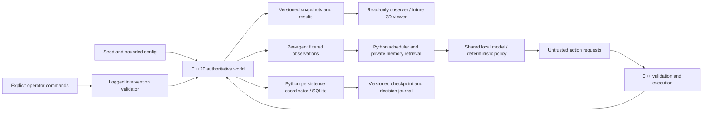

# Architecture

Phase 4 is current: [PHASE4_TEACHING.md](PHASE4_TEACHING.md) specifies closed/guided operator channels, gated native book reading, report lineage, explicit mass/energy sources and immutable-parent forks with law versions. Provider input remains one inhabitant's permitted view. SQLite schema 4 / native UW3 deliberately supersede earlier formats. The following phase descriptions/proposals are historical where superseded.

Phase 3 adds seeded identity, private episodic memory, bounded lexical retrieval, observed relationships and one-step plans around the unchanged native bodies/needs/actions. [PHASE3_COGNITION.md](PHASE3_COGNITION.md) specifies the current scheduler, provider, privacy, persistence and replay boundaries. [PHASE2_AGENCY.md](PHASE2_AGENCY.md) preserves physical/utility rules and [PHASE1_MECHANICS.md](PHASE1_MECHANICS.md) preserves mechanics decisions. A pinned local CPU adapter has real-run evidence; the model-off utility world remains the default. Interventions, chemistry and a 3D viewer remain planned. Later sections preserve earlier proposals where not superseded.

## Ownership and boundary decisions

C++ owns physical truth: time, positions, inventory, needs, materials, action preconditions and effects. Python owns scheduling, provider adapters, agent-specific memory and experiments. Python does not reproduce simulation rules. At Phase 0 its subprocess call only obtains an initial scene. Phase 1 introduces batched `step`/`observe`/`export_state` bindings through pybind11 after the kernel works; per-particle Python callbacks are excluded.

Stable entity strings are unique inside a run. Durable references use `(run_id, entity_id)`; branches retain entities and assign a new run ID plus parent checkpoint. Future deletion never recycles IDs. Tick and event sequence are monotonically increasing integer counters. Physical state is continuous-coordinate 2D; viewing a snapshot never advances time.

Start with explicit circular actors, bounded movement and a uniform spatial grid. Add Box2D only if measured mechanics justify a dependency. Rendering consumes state and cannot decide physics. A future 3D scene initially maps `(x,y)` metres to horizontal `(x,0,y)` and retains 2D mechanics.

## Scheduling proposal

Fixed physics step: 0.1 simulated seconds; cognition eligibility every 50 ticks (5 simulated seconds). Baseline population 8; allocation guard 64 is not a benchmark-supported population. At a decision boundary logical time will pause for the bounded decision batch; wall time may pass but needs will not decay. Commit a valid decision or deterministic timeout fallback, then resume physical ticks. One model instance, one concurrent request, separate prompt/history/memory per agent. Global cap 96 provider calls per simulated day; ordinary survival remains a cheap policy. These are initial budgets awaiting measurement, not implemented scheduling.

## Persistence proposal (Phase 1)

Use Python stdlib SQLite, one writer, rollback journal (`journal_mode=DELETE`), `synchronous=FULL`, foreign keys on. Stage each candidate tick in memory. One `BEGIN IMMEDIATE` transaction inserts validated external decisions, tick events, complete versioned authoritative state (including RNG, pending actions, entity counter and scheduler state), memories generated from those events, and a run-head pointer. Commit before publishing the new state to observers. Roll back on error and discard staged state. No model call inside a database transaction. Journal decisions before exposing their effects; never recompute model choices during replay.

On restart load only the last committed run head. Uncommitted in-memory work may be lost (at most one tick under the proposed one-tick transaction boundary); no partially published tick is accepted. This is a design, not crash-recovery evidence. Model binaries and prompts need version/hash references. Keep complete current state plus bounded recent events; archive experiment evidence before pruning. Proposed event cap 10,000; compaction must preserve checkpoint/decision dependencies and provenance references. Implement quota/backpressure before claiming bounded disk in long runs.

Use SQLite's backup API for live database copies, not raw copying of an active database. WAL is deferred; if introduced, revisit checkpointing/backup and filesystem assumptions. Actual durability depends on storage honoring flush operations. Test process kill/restart separately from deterministic save/resume. Checkpoint branch creation must be atomic and record laws/config hashes. Operator read queries receive no mutation handle.

## Security and reproducibility boundaries

Models receive filtered observations and only that agent's accessible memories. An observer snapshot contains privileged world state and is never a cognition input. Dialogue/books remain quoted untrusted world data. No shell/file/network tool is provided to inhabitants. Closed mode disables external providers; later process/network isolation requires explicit verification. Guided mutations enter only via logged operator commands. Replay includes seed, config, build/schema IDs, external decisions and interventions; determinism is scoped to the same supported build/runtime. Pausing does not advance simulated time; no offline catch-up is promised.

## Phase 7 supervision

The C++ world remains authoritative; UW6 adds cumulative event counts and retirement of completed canonical utility/script receipts. Python maintains a leased single writer, individual physical-tick transactions, bounded cognition queue and hash-checked epoch summaries in DB7. Windows AppContainer disables worker network capabilities. Explicit local-model inference uses a bounded inherited JSON pipe to a host loopback-only adapter. The supervisor owns a kill-on-close memory-limited job, heartbeat, stop request and watchdog. Rotation replaces the active replay root after publishing a bounded archive; only the retained history window is replayable. See [PHASE7_OPERATIONS.md](PHASE7_OPERATIONS.md) for boundaries and failure behavior. Longer horizons remain deferred; the Phase 8 presentation boundary is described below.

## Phase 8 presentation boundary

The viewer consumes `underworld.viewer/1` over loopback HTTP. One SQLite read transaction projects the native checkpoint, selected-agent perception/own memory, retained events and operator history. The browser maps `(x,y)` to `(x,illustrative_height,-y)` and owns only camera/presentation state. All time controls and guided interventions retain the existing controller/native validation path. A read-only controller skips recovery/writer startup and can attach to an AppContainer run while its writer lease is held. Reconnection and graphics recovery reload presentation without advancing the world.

Three.js 0.180.0 assets and license are pinned locally. The viewer source manifest is versioned separately from the unchanged C++ build and durable orchestration identity, so existing Phase 7 UW6/DB7 data stays compatible. The legacy 2D route remains available. See [PHASE8_VIEWER_PROTOCOL.md](PHASE8_VIEWER_PROTOCOL.md) for security, cursor, coordinate, measurement and retention contracts. True 3D mechanics would require a separate authoritative-engine migration.

## Phase 9 research boundary

`underworld.learning` is an opt-in experiment module, excluded from utility/provider execution. It has a separate schema-1 SQLite policy journal with at most 72 training reservations per seed. A reservation captures the owner's own inventory features, exact request, pre-action native checkpoint/head, and current weights. After native execution commits, finishing restores the pre-action checkpoint and verifies that executing the recorded request yields the exact committed native head and terminal receipt. Only completion or native INSUFFICIENT_RESOURCE rejection supplies a label. Other failures stop the experiment.

World and policy commits are separate. A completed physical action can be reconciled exactly once after reopening the policy store. A reservation without a committed request stays pending and blocks new training; recovery never resubmits it. A partial physical action is not a success label. A changed/foreign head, wrong actor/source, tampered checksum or invalid update chain is rejected. Checksums detect accidental edits, not a hostile writer capable of rewriting all evidence. Existing leases serialize cooperating writers.

The fixed-study runner gathers inventory through native actions in fresh three-second-or-shorter episodes. For each held-out case it writes predictions before obtaining a native probe label, backs up the same head into four physical policy rollouts, and verifies replay and material conservation. Evaluation never changes weights or receipt memories. The unchanged UW6/DB7 runtime and viewer remain compatible; learner/runner sources have separate hashes. See [PHASE9_PREREGISTRATION.md](PHASE9_PREREGISTRATION.md) for the hypothesis, controls, budgets and advancement rule.

## Stabilization execution boundary

The opt-in `underworld.stabilization` controller owns explicit goals and a writer lease. It converts survival intents into authored navigation, gathering and consumption, using only each actor's permitted perception and own memory. It checks alternative perceived approach points, fresh inventory/supply/reach, terminal receipts and actual ingested mass. The legacy compiler/utility policy and native validator remain unchanged for comparison. No Phase 9 learner is imported.

An explicit handoff disables old automatic dispatch and records superseded pending plans. Additional `stabilization_meta`, `stabilization_agents` and hash-chained `stabilization_events` tables retain goal, request, inference-budget and navigation state. A control reservation and native tick have separate commits; recovery reconciles the durable native journal and never duplicates a committed consumption. SQLite backups include both kinds of state. Native hashes/replay and control-table/source checks remain separate guarantees.

The controller is a bounded host-side runner, separate from the Phase 7 AppContainer supervisor and the viewer's manual time controller. Read-only viewing remains available. Legacy provider/call counters describe the disabled old scheduler; new calls and fallback attribution live in the new journal. See [STABILIZATION_OPERATIONS.md](STABILIZATION_OPERATIONS.md) for handoff/resume and [STABILIZATION_REPORT.md](STABILIZATION_REPORT.md) for measured scope and retained failures.

## Living-world Milestone B boundary

The current opt-in living-world profile extends the native boundary with stable tree entities, finite tree biomass, explicit young-tree boundary growth and material piles. Native `inspect_tree`, `harvest_branch`, `fell_tree` and `collect_wood` actions use the same observation-version, visibility, reach, capacity, pending-action and terminal-receipt rules as existing actions. Python bindings expose tree stage/health/biomass and material identities but do not decide physical success. The viewer remains presentation-only and now distinguishes trees and wood/fiber/stone piles.

These changes intentionally create native checkpoint format UW7 and durable SQLite user_version 8 / checkpoint schema 7. UW6/DB7 worlds are historical and fail closed rather than being silently migrated. Tree growth is an authored ecological boundary source, not a claim of molecular photosynthesis. Crafting, tools, animals and autonomous tree planning remain later milestones.

## Milestone C current boundary

`core/crafting.cpp` supplies a reusable native recipe table and validators for ingredient transformation, tools, reserved sites, work and contents transfers. Entity composition, ownership, tool durability and construction progress serialize into UW8. DB9/checkpoint schema 8 store the same native state through ordinary one-tick transactions. Owned-tool mass participates in the carrying limit and private own-state capacity calculation. Construction footprints, closed fences/gates and storage are authoritative solids.

`underworld.workshop` is a fixed, explicitly assigned development procedure routed through the coordinator and lease. `scripts/phase_c_demo.py` records its external source separately from physical skill, checkpoints partial construction, compares fresh-process continuation, and retains receipts. It is not a new autonomous planner. `stabilization/3` accounts for owned tools during survival gathering; its earlier studies and failed Phase 9 study remain historical. Stabilized worlds accept read-only observer attachment; their time is driven through `living-world run`, preventing the legacy observer from substituting another scheduler. The missing A model-budget/fairness work and full supervisor integration are not covered by this milestone.

## Milestone D current boundary (UW9 / DB10)

`core/ecology.cpp` owns two stable native animals, bounded local sensing/handling, shared swept-circle movement, forage, production clocks, integer reserve transfers and aggregate retained waste. SQLite still advances one authoritative world tick under its existing lease; animals add no Python scheduler or inference calls. The ecology profile is new-world-only and opt-in through config/living-world-d.toml. Native/source/config pins fail closed on older formats; original files remain intact.

The privileged snapshot contains full animal reserves/history and waste/freshness ledgers. Agent observations expose local appearance and condition only; observe_animal returns its own sourced report, not other caretakers' private history. Food lifetime travels conservatively through storage and collection. The Phase 9 learner is never imported by this execution path. The evaluation care route is explicitly operator assigned, and diagnostic fixture editing never runs inside live policies. See PHASE_D_ECOLOGY.md for units, inputs, timing, mass equations and omissions.
# Milestone E extension — 21 October 2026

Python planning.py supplies explicit authored hierarchical tasks inside the
existing stabilization writer, with private receipt-derived hypotheses and
procedure references. planning_model.py can select a bounded next operator;
it never supplies physical effects. Controller v4 hashes all three control
modules and keeps task pending ownership, cancellation and source evidence in
the checksummed coordinator state. No additional writer or native-law change.
Read [E report](LIVING_WORLD_E_REPORT.md) and [operations](PLANNING_OPERATIONS.md).
